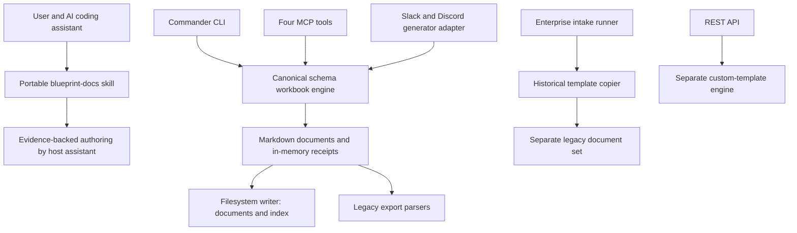

# Repository Functionality and Product Audit

**Observed:** 2026-10-21 local / 2026-10-22 UTC

**Code inspected:** `1c5913bb18be8a908b08018f28978b486308024e`

**Audit bead:** `blueprint-44b`

**Scope:** Local code, clean lockfile installation, CLI/library/MCP package, enterprise generation, export preview, REST behavior, tests, release distribution, and documentation drift.

This is a historical snapshot of the inspected commit. Subsequent repairs and verification are recorded in [the remediation evidence](014-AA-AUDT-functionality-remediation.md).

## 1. This system in five minutes

**The documentation core works. The broader enterprise platform is only partially integrated, and the advertised v3 installation does not work.** A clean build passes; 222 tests pass with three optional evaluations skipped; an actual packed tarball installs in a separate consumer and runs its library, CLI, and four MCP tools. Those results establish a functioning workbook product, not complete enterprise functionality.

The useful product is a documentation workflow for an AI coding assistant. Its portable skill tells the host assistant to inspect evidence, select a small set of documents, draft useful content, and label assumptions. Its deterministic engine creates the document structure, metadata, evidence sections, and traceability scaffolding. The host assistant does the substantive authoring. Running `blueprint generate` alone produces workbooks with unknowns, not researched or completed plans. This distinction is explicitly stated in `skills/blueprint-docs/SKILL.md:35` and implemented in `packages/cli/src/core/renderer.ts:81`.

The repository accumulated a marketplace, plugins, analytics, four project-management integrations, a separate REST template engine, model-provider clients, team configuration, bots, forms, PDF tooling, and an email helper. Some have meaningful implementations, but they do not form one verified product journey. In particular, the enterprise generator still bypasses the modern core, and GitHub export mistakes modern workbook headings for tasks.

**Recommendation:** Treat the portable skill, schema workbook engine, CLI, and MCP as the supported product boundary. Repair installation, dependency currency, enterprise divergence, export semantics, and CLI input handling before presenting the repository as an enterprise platform. Decide the future of optional surfaces explicitly; this audit did not delete or redesign them.

Assessment: **usable core, incomplete product integration, stale distribution and operating records**. A numeric health score would obscure those separate conditions.

## 2. Identity, history, and environments

The project is a TypeScript/npm workspace monorepo owned by the Intent Solutions project account. `packages/cli/package.json` names the product `@intentsolutions/blueprint@3.0.0`; the root also declares `3.0.0`. The second workspace, `@intentsolutions/blueprint-chatbots`, declares `2.6.0`. That difference is a separately versioned package, not by itself a release failure.

| Environment or artifact | Observed state |
|---|---|
| Repository main | Local HEAD and remote main matched `1c5913b` at inspection |
| Clean development checkout | Installation and build succeeded; tests succeeded after build |
| Locally packed v3 consumer | Library, CLI, and stdio MCP smoke succeeded |
| Published npm package | `latest` was `2.8.0`; `3.0.0` returned E404 |
| Remote v3 tag | No `refs/tags/v3.0.0` returned by `git ls-remote` |
| Hosted application | No verified hosted product was established by this audit |
| Authenticated bot/export deployments | Not exercised; no messages or external records were created |

Meaningful product work landed in August through the model-neutral platform changes and release fixes. September includes a packaging race fix, dependency updates, and recovered PDF/email tools. Latest inspected commits date to September 25. This is more specific than saying the repository is simply abandoned: current source contains a substantial v3 migration, but npm distribution still exposes the older product.

The release work records are stale. `blueprint-i0k.4` and `blueprint-yn2.4` still describe PR #45 as awaiting approval. The connected GitHub PR record confirms that [PR #45](https://github.com/jeremylongshore/intent-blueprint-docs/pull/45) merged September 25 as `4f32cfb`. That historical review blocker is no longer the current explanation for an unpublished v3. The audit did not infer a new blocker or close those existing tasks.

## 3. Architecture and critical paths



The default canonical flow is `cli.ts` or `mcp/index.ts` → `core/index.ts` → catalog lookup and scope selection → `core/renderer.ts` → `writeDocuments` when explicitly requested. The catalog binds historical IDs to schema-backed definitions. The renderer validates metadata, evidence references, trace graphs, examples, and review state. It refuses automatic approval. The writer emits Markdown and `index.md`.

The default scope sizes are 4, 12, and 22. Unit and generation tests cover these. Template selection checks the packaged historical corpus as well as the typed definitions. Consequently, the package mirror must exist even when default rendering uses schema definitions. `professional-templates/core/` is the historical source; `packages/cli/templates/core/` is the generated packaging mirror. The `scripts` directory is a symlink to `05-Scripts`, not an independent second script implementation.

Important boundaries do not share this path. `05-Scripts/generate-enterprise.mjs` reads historical files directly. `enterprise/api/server.ts` uses `enterprise/templates/engine.ts` and starts with no templates unless callers load custom templates. The marketplace and analytics handlers have their own dispatcher in `commands/index.ts`; the installed executable uses Commander in `cli.ts` and does not register those commands.

The runtime dependency footprint is much larger than the workbook engine. Counting TypeScript source lines for context, not as a quality metric: core is 891 lines, interview 1,178, MCP 282, enterprise 4,824, integrations 4,681, marketplace 6,535, analytics 1,031, and plugins 1,771. Some marketplace lines are embedded template content. Most surface area therefore sits outside the narrow path with the strongest behavioral evidence.

## 4. Design decisions and tradeoffs

These are observed choices and their implications; where historical intent is not recorded, the reasoning is an audit interpretation.

| Choice | Benefit | Cost and point for reconsideration |
|---|---|---|
| Host assistant authors; core renders deterministically | Model-neutral operation, repeatable structure, explicit unknowns | A CLI user can mistake a generated workbook for a completed plan. Position the output accurately and prove a useful authored example. |
| Typed catalog and Zod schemas | Stable IDs, evidence validation, explicit compatibility | Adapter migrations must keep pace. Export parsers and enterprise scripts currently do not. |
| Historical corpus plus generated package mirror | Backward compatibility and self-contained npm artifact | Additional freshness requirements. Keep check-only packaging and pre-build drift checks. |
| One npm artifact for library, CLI, and MCP | Shared code and a real consumer smoke test | All advertised installation paths depend on publishing that artifact. Source version alone is insufficient. |
| Stateless MCP interview | Simple stdio integration without server session storage | Caller must resend previous answers. CLI and MCP must preserve the same question semantics. |
| Many optional subsystems in one package | Broad integration potential | Large maintenance and dependency footprint without comparable behavior coverage. Split or retire only after a product-scope decision. |

No autonomous research engine runs in the core generation path. There is no demonstrated graphical editor or real-time collaboration application in the inspected paths. Model clients exist, but normal generation does not invoke them. `blueprint model use` is described in CLI help, while its action switch implements `list`, `test`, and `info`; selection is not shown to persist into generation (`cli.ts:904`).

## 5. Directory structure and load-bearing files

| Path | Role |
|---|---|
| `skills/blueprint-docs/` | Portable authoring workflow and integrity guidance |
| `packages/cli/src/core/catalog.ts` | Canonical typed workbook definitions and scope mapping |
| `packages/cli/src/core/schema.ts` | Metadata, evidence, graph, and receipt contracts |
| `packages/cli/src/core/renderer.ts` | Default schema workbook renderer |
| `packages/cli/src/core/index.ts` | Lookup, compatibility rendering, multi-document generation, writing |
| `packages/cli/src/cli.ts` | Installed CLI command registration and actions |
| `packages/cli/src/mcp/index.ts` | Four stdio tools and their input validation |
| `professional-templates/core/` | Read-only historical corpus |
| `05-Scripts/sync-templates.mjs` | Package mirror synchronization and freshness check |
| `05-Scripts/smoke-packed-artifact.mjs` | Installed-consumer library, CLI, and MCP verification |
| `form-system/`, `05-Scripts/*enterprise*` | Separate legacy intake/generation path |
| `packages/chatbots/` | Slack/Discord adapters, ZIP generation, delivery |
| `tools/pdf/`, `tools/email/` | Recovered standalone tools outside npm workspaces |
| `000-docs/`, `01-Docs/` | Canonical and historical documentation with remaining drift |

Breaking schema, catalog, renderer, adapter registration, mirror synchronization, or package entrypoints breaks the supported path. Other directories may compile while remaining disconnected from it.

## 6. Getting started from verified source

This audit ran Node `22.23.1` and npm `12.0.1`. The repository declares Node 20+ and npm `10.0.0`; CI names Node 20, 22, and 24. Only Node 22 was executed in this audit. Use a clean checkout and the lockfile:

```bash
git clone https://github.com/jeremylongshore/intent-blueprint-docs.git
cd intent-blueprint-docs
npm ci
npm run templates:check
npm run build
npm test
npm run lint
npm run verify
npm run skill:check
node packages/cli/dist/cli.js list --scope mvp
node packages/cli/dist/cli.js generate \
  --name "Booking Proof" \
  --description "A booking site for a mobile dog grooming business" \
  --scope mvp \
  --output /tmp/blueprint-booking-proof
```

Expect four workbooks plus an index. Review the generated content as a draft requiring authoring. For a repository-local MCP connection, after building, a client can invoke `node` with the absolute path to `packages/cli/dist/mcp/index.js`. The checked-in `.mcp.json` currently invokes the unpublished npm version instead.

The fresh installation was performed in a `git archive HEAD` copy under `/tmp`, using `npm ci --ignore-scripts --no-audit --no-fund`. Ignoring lifecycle scripts isolated installation; subsequent explicit build, tests, lint, checks, and consumer smoke verified the needed binaries. It does not prove every possible third-party install hook.

The existing workspace had stale installed versions: Vitest 4.1.8 versus declared 4.1.11, harness 1.3.1 versus declared 1.4.0, and Nodemailer 9.0.6 versus declared 9.1.1. `npm ls` reported invalid dependencies there. The clean install resolved the declared lockfile versions. Its harness verification passed. A local stale-harness verification failure therefore must not be reported as a committed policy defect.

## 7. Operations and reproducible verification

| Check | Result and practical meaning |
|---|---|
| Fresh lockfile installation | Passed in isolated source copy |
| `npm test` before any build | Failed: 2 packed-artifact tests; 190 passed, 3 skipped |
| `npm run build` | Passed for both workspaces |
| `npm test` after build | Passed: 192 root + 30 CLI; 3 optional evaluations skipped |
| Chatbot workspace test command | Exited successfully with no test files |
| `npm run lint` | Passed |
| `npm run verify` | Passed: corpus, mirror, declared release version |
| `npm run skill:check` | Passed |
| Clean `audit-harness verify` | Passed with harness 1.4.0 |
| Local `audit-harness conform .` | 10 pass using stale local harness 1.3.1; structural evidence only |
| Actual packed v3 installed consumer | Passed: 22 templates, CLI 3.0.0, four stdio MCP tools |
| Enterprise fixture runner | Exited 0 and produced 24 Markdown files |
| Enterprise intake sensitivity | Failed functional expectation: different intakes yielded identical PRD bodies |
| GitHub export local preview | Proposed 47 tasks from unfilled workbooks |
| Default REST service | Healthy response, zero templates, nonpersistent webhook acknowledgement |
| `npm audit --omit=dev` | 10 affected package entries: 2 critical, 6 high, 2 moderate |
| npm `3.0.0` lookup | E404; registry latest 2.8.0 |

The packed-consumer check used `npm pack`, installed that actual tarball into a fresh prefix, and ran `scripts/smoke-packed-artifact.mjs` from the clean checkout. It exercised real stdio negotiation, not just workflow text assertions. The package is distributable locally; publication is the missing external step.

The release workflow includes build/test, tarball smoke, SBOM, attestation, publish, integrity verification, and receipt generation. Their existence does not establish that v3 completed that workflow. No release was triggered during this audit. Follow the established release approval process before tagging or publishing.

No hosted availability, alerting coverage, on-call arrangement, or production SLO was verified. For the supported artifact, operational failures primarily concern build, generation, package availability, and host integration. Diagnose those with the command results above before investigating optional services.

## 8. Concrete defects and sharp edges

### A. Advertised installation references a missing release — high

`README.md:48`, `README.md:63`, and `.mcp.json` require npm version 3.0.0. `npm view @intentsolutions/blueprint@3.0.0 version --json` returns E404. The registry lists versions through 2.8.0. New users following the install fail before reaching working code. Provide a tested checkout-based path and accurate release status; complete publication only through the release workflow. Tracked as `blueprint-owe`.

### B. Enterprise intake does not affect document bodies — high

`05-Scripts/generate-enterprise.mjs:100` copies each historical template and changes its date. `readIntake` loads content but generation only uses the existence flag and link. In two isolated fixture directories, different intake text produced byte-identical PRD bodies after excluding the project header. Neither output contained the distinctive requirement, and neither used schema metadata. The full runner nevertheless exited successfully.

`05-Scripts/verify-enterprise-output.mjs` verifies count, index, and log presence. Those assertions establish file production, not project-specific correctness. Route through the canonical engine or explicitly retire the legacy path. Add a content-sensitive acceptance fixture. Tracked as `blueprint-2t8`.

### C. Export turns workbook structure into tasks — high

`packages/cli/src/integrations/github/exporter.ts:168` parses level-two and level-three headings as task titles with a short generic exclusion list. A 22-document v3 set produced 47 preview tasks, including “How to use this workbook,” “Project context,” “Evidence,” and “Assumptions,” with no actual project task data supplied. The preview makes no network writes; real export uses the same extraction method before issue creation.

The semantic mismatch is directly demonstrated for GitHub. Linear and Jira require their own fixtures before claiming the same exact counts or behavior. Use explicit task records and fail closed on unfilled workbook sections. Tracked as `blueprint-828`.

### D. Conditional CLI interview questions are frozen too early — medium

`packages/cli/src/cli.ts:186` gets all groups once before collecting answers. At that point compliance is inactive and competitor-name questions are excluded. Supplying enterprise/payment/competitor answers makes these questions active in a fresh `getQuestionGroups()` result, but the CLI loop still traverses its original snapshot. The loop also checks answered status without reevaluating each question's condition. The underlying engine can recalculate; the CLI fails to do so. Tracked with other concrete CLI flow defects as `blueprint-gbb`.

### E. Invalid scope reports successful empty generation — medium

`blueprint generate -n 'Bad Scope' -d 'Audit invalid scope' -s nonsense -o <temporary-directory>` exits 0, prints “Generated 0 documents!”, and writes an empty index. The CLI casts strings to TypeScript unions, while `core/index.ts:111` filters the catalog without runtime scope rejection. The MCP tool uses enum validation and rejects this class of input. Both adapters should enforce a clear input contract. Tracked as `blueprint-gbb`.

### F. README test order fails on a clean checkout — medium

`README.md:76` runs tests before build. Root `test/packed-artifact.test.ts:12` inspects `dist` contents and line 30 invokes a built CLI, but root `npm test` runs those tests before Turbo builds workspace dependencies. The clean reproduction failed exactly two tests. Building first resolved them. CI already builds first; local instructions and standalone test orchestration need to agree. Tracked as `blueprint-gbb`.

### G. Optional features are not a connected platform — medium

`blueprint pack list` is an unknown command. Marketplace and analytics handlers exist in `commands/index.ts`, but the actual executable does not call that router. `blueprint sync` prints “coming soon” (`cli.ts:587`). A default REST server returns zero templates while health asserts template availability. `POST /api/webhooks` returns 201, but a subsequent GET still returns an empty list; handlers explicitly say placeholder (`enterprise/api/server.ts:532`).

These findings are more useful than treating every source file as a shipped capability. Product vision describes analytics as completed, collaboration as beta, and Slack/Discord as planned even though bot code already exists. Contributor guidance also names a different clone organization, ESLint/Prettier enforcement, and adjacent tests; actual checks use Oxlint and dedicated test directories. Tracked as `blueprint-vdh`.

### H. Receipts are generated but ordinary writes do not persist them — medium

`core/renderer.ts` constructs a hashed generation receipt and returns it with content. `core/index.ts:183` writes document content and an index only. CLI output therefore omits the receipt object; MCP generation preview also omits it. Markdown does retain metadata. Callers requiring reproducible provenance must explicitly preserve receipts through the library today. Decide a persistent receipt contract before claiming complete provenance across every adapter. Tracked as part of `blueprint-vdh`.

## 9. Security and access

Implemented controls include catalog-bound lookup, MCP input validation, preview-before-write default, schema validation, explicit human review, and isolation of illustrative examples. Local protocol tests reject traversal IDs. These are meaningful controls within the canonical path.

The production dependency report from the clean lockfile installation identified ten affected package entries. Critical entries were `handlebars` and `proxy-addr`; high entries included `@modelcontextprotocol/sdk` and `nodemailer`. The companion evidence JSON records affected packages, severities, ranges, and fix availability. Counts are package-level npm findings, not ten demonstrated exploits in this application. No exploitability claim follows from the audit alone: assess which affected interfaces are reachable through retained product surfaces. Track remediation as `blueprint-1jr`.

The REST service binds localhost by default and allows an optional API key. Its rate-limit setting is stored but has no enforcement use in `server.ts`, and its body parser buffers without a configured size limit. Treat that as an experimental service boundary until deliberately hardened and tested for its intended deployment. This audit ran it only on loopback with no secrets.

No live export credentials, model calls, email sends, chat messages, or public service exposure were required. No secret values were inspected or placed in evidence. PDF rendering and the recovered email helper were inspected as peripheral code; rendering and delivery were not validated end to end.

## 10. Cost and performance

Canonical rendering runs locally and performs no model API call. Substantive authoring consumes the host assistant's resources. Optional model tests, chat integrations, delivery, and external exports introduce their own service costs; none were invoked for this audit. No monthly infrastructure bill or usage-based cost was established.

The observed clean build took about 21 seconds on this shared machine. That is a diagnostic measurement, not a product latency benchmark. No load or concurrency SLO was measured. File writes and much core rendering are synchronous; output is bounded by 22 definitions per comprehensive generation but content inputs are not a demonstrated multi-tenant service budget.

One representative comprehensive workbook set contained 772 literal “Unknown” occurrences. That count shows what the renderer intentionally leaves for authoring, not a performance defect. It also shows why generated file counts are a poor success measure for the product. The business outcome should be an evidence-backed plan a user can review.

## 11. Current implementation and test confidence

| Component | Status | Evidence boundary |
|---|---|---|
| Portable documentation skill | Implemented | Workflow and structural checks; authored plan quality not evaluated in this run |
| Typed catalog and schema core | Working | Generation and evidence/graph rejection tests |
| Library, CLI, stdio MCP package | Working after build | Real installed tarball smoke and protocol tests |
| Adaptive interview engine | Implemented | Recalculation works; CLI question snapshot is defective |
| Enterprise runner | Produces files; functionally divergent | Distinct intakes do not change bodies |
| GitHub export | Incorrect v3 task extraction | 47 spurious proposed tasks in preview |
| Linear/Jira/Notion | Implemented code, incomplete evidence | No authenticated service tests performed here |
| REST custom-template service | Experimental | Empty default catalog, placeholder webhooks |
| Marketplace/analytics | Partially disconnected | Actual executable lacks the handlers advertised by separate router |
| Plugins/team/model helpers | Implemented modules | Not established as an end-to-end generation journey |
| Slack/Discord | Compiles, runtime unverified | Workspace test command explicitly permits no tests |
| Standalone PDF/email tools | Peripheral | Outside workspace build/test denominator |
| npm v3 distribution | Missing | Registry E404 and absent remote v3 tag |

The 222 passing tests are substantial evidence for the catalog, schemas, static template quality, integrity boundaries, packaging structure, and selected protocol behavior. They do not cover every module that compiles. The three skipped cases are optional LLM quality evaluations, not silently failed core tests. No measured 80% coverage result was produced; the documentation's target is not an achieved statistic. Several release tests assert workflow text, so real installed-consumer verification remains necessary.

The historical `TEST_AUDIT.md` dated August 29 records zero production vulnerabilities and a B grade. Those were historical observations; the current advisory result supersedes their use as present-tense evidence. Likewise, old notes saying all epics are closed conflict with the live open/in-progress Beads records. Do not infer current completion from narrative notes.

## 12. Recommended direction and tracked work

The first stabilization outcome should be that a new user can install or build the actual product, generate an appropriately scoped workbook, use the host assistant to author it, and see exactly what still requires evidence. That means truthful distribution guidance (`blueprint-owe`), dependency review (`blueprint-1jr`), and correct clean-start/CLI behavior (`blueprint-gbb`). Publication remains a separate approved release action.

The next integration outcome should be one canonical generation behavior and exports that carry real task data. Reconcile the enterprise copier (`blueprint-2t8`) and replace heading-based task assumptions (`blueprint-828`). Keep the stronger metadata and evidence semantics rather than weakening them to accommodate old adapters.

The product decision is whether marketplace, analytics, REST, model configuration, team features, and delivery bots deserve active support. Make that decision using an actual user workflow and usage evidence, not source-file existence. `blueprint-vdh` tracks the claim/support boundary. A useful demonstration would take one real project through intake, a small authored document set, review, and an accurate export preview. No such demonstration was established by this audit.

Avoid starting another broad rewrite before these defects are resolved. The current implementation contains enough reusable value to justify a focused product; its support promise should match the tested path.

## 13. Quick reference and handoff

Use the source commands in section 6 for local operation. `npm run verify` checks more than `make verify`: the npm command adds mirror and declared-version checks. Neither command verifies npm publication. The current local source is v3; use `npm view` for registry evidence.

The audit artifact is this document plus `audits/2026-10-22-repository-functionality-evidence.json`. Six discovered follow-ups are recorded in Beads and remain open. Existing release epics/tasks were inspected but not closed or claimed. Product source, templates, package versions, and release tags were not changed by this audit.

### Appendix: minimal defect reproduction

After building, this local-only script demonstrates export semantics without creating external records:

```js
import { generateAllDocuments, GitHubExporter } from './packages/cli/dist/index.js';

const context = {
  projectName: 'Booking Proof',
  projectDescription: 'A booking site for a mobile dog grooming business',
  scope: 'comprehensive',
  audience: 'business',
};
const docs = generateAllDocuments(context);
const exporter = new GitHubExporter({ token: 'unused', owner: 'audit', repo: 'unused' });
const preview = await exporter.preview(docs, context);
console.log(preview.tasks.map(task => task.title));
```

For enterprise sensitivity, create two isolated working directories containing the historical corpus and different `completed-docs/<project>/enterprise-intake.md` files. Invoke the repository's absolute `generate-enterprise.mjs` path with each directory as cwd. Compare the generated `01_prd.md` after the header separator. Both bodies are identical at the audited commit. Using an absolute `--out` path also fails because the script joins it beneath cwd; use a relative output directory for this reproduction.

Open questions requiring product evidence are actual user adoption, desired supported adapters, authority for the next release, and whether any external bot or REST deployments exist. This audit establishes code behavior, not the answers to those business questions.
